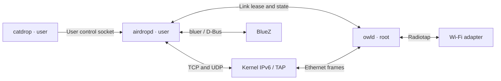

# Workspace and privilege separation

[README](../README.md) · [Usage](usage.md) · [Protocol](protocol.md)

| Crate | Executable | Responsibility |
| --- | --- | --- |
| `owl` | `owld` | Privileged WLAN setup, AWDL protocol, scheduling, aggregation and restoration. |
| `airdrop` | `airdropd` | User-owned HTTPS, UDP mDNS, BLE, contact validation, archives and approvals. |
| `catdrop` | `catdrop` | User-facing send, discoverable, contact, accept/reject and status commands. |
| `owl-ipc` | Library | Bounded link messages, link addressing and deadline data. |

The radio crate does not depend on AirDrop, OpenSSL, archive or Bluetooth code.
The user crates do not depend on radio setup, netlink, libpcap or TAP creation.
All project crates forbid unsafe code; library wrappers own native interaction.

## Link ownership

`owld` starts with WLAN inactive and permits one authorized user connection to
own the radio at a time. `--user` selects the authorized account; under sudo the
invoking account is the default. Its runtime directory must belong to the radio
service and must not be writable by other users. Peer credentials authorize IPC;
the user client verifies the server UID is root.

The user daemon decides whether a BLE wake matches the current discoverability
policy. Only eligible wakes acquire or refresh the user session. Outgoing work
also acquires the same session. Identity keys, known contacts, transfer metadata
and output paths remain in `airdropd`. The CLI prepares source archives and
sends requests over the user control socket; it never loads identity keys or
runs the transport service. Sending requires both daemons to be running.

The first radio request is `Acquire { port }`; the service uses its own CLI radio
configuration and returns a generation ID, actual MAC, link-local address,
interface index/name and heartbeat deadline. Exclusive leases reuse the radio
daemon's random MAC; shared mode retains the AP station's current MAC.

`State { generation, service_enabled, transfers, transfer_epoch }` publishes public service
visibility only after HTTPS and mDNS sockets have been bound, and reports the number
of active transfers. `owld` uses this count to hold the selected transfer channel;
it has no knowledge of HTTP requests, filenames or contact authorization.
Activity revisions increase when transfers start or end. Once its selected channel
and width are committed, `owld` returns `ChannelReady { generation, transfer_epoch }`.
The sender waits for its revision (or a newer active revision) before starting
`/Upload`; snapshots and older readiness events cannot unblock it. The wait is
bounded by `--channel-ready-timeout` (15 seconds) and fails if the radio link closes.
Channel selection and tuning remain entirely in `owld`. Readiness confirms local
tuning, not that the peer is currently listening; AWDL slot gating still applies.
Periodic State messages refresh the connection lease; link snapshots do not.
Stale generations and malformed or oversized messages terminate the lease.
Framing is cancellation-safe and bounded to 1 MiB per message.

## Networking and cleanup

Bulk file data travels through the kernel's IPv6/TCP stack and the TAP, rather
than the control socket. `airdropd` binds TCP and UDP sockets to the leased
interface. UDP mDNS joins `ff02::fb`, selects the outgoing address/interface,
and validates received interface and hop-limit metadata. The kernel constructs
Ethernet/IP/UDP headers. Root-owned neighbor-learning ICMP probes remain in the
link runtime. Host routing and filtering apply; no VPN/firewall rules are changed.

Normal shutdown stops HTTPS, sends UDP mDNS goodbyes and releases BLE advertising
before sending Release to owld. The radio service withdraws its AWDL service,
drains TX, removes owned interfaces and restores its WLAN journal before replying
Closed. The user daemon waits for this confirmation before admitting a new session.

Startup and release deadlines cover the complete IPC exchanges, including
writes. Idle connections awaiting their first request are cancelled when
`owld` stops.

A user crash closes the connection, causing the same radio cleanup. Heartbeat
expiry also cleans up an unresponsive client. Radio startup and restoration stay
owned by the radio worker even if the requesting client disappears midway.
A radio service restart recovers an interrupted journal before accepting clients;
existing user sessions fail and later operations obtain a new generation.

Use `owld --no-radio` and `airdropd --no-radio --no-bluetooth` for separate local
lifecycle diagnostics. The radio loopback backend is permitted without root and
does not alter WLAN; production AirDrop clients still require a root owld peer.
