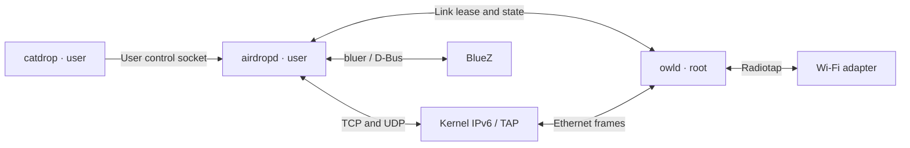

# Workspace and privilege separation

[README](../README.md) · [Usage](usage.md) · [Protocol](protocol.md)

| Crate | Executable | Responsibility |
| --- | --- | --- |
| `owl` | `owld` | Privileged WLAN setup, AWDL protocol, scheduling, aggregation and restoration. |
| `airdrop` | `airdropd` | User-owned HTTPS, UDP mDNS, BLE, contact validation, archives and approvals. |
| `catdrop` | `catdrop` | User-facing send, discoverable, contact, accept/reject and status commands. |
| `airdrop-client` | Library | AirDrop control protocol, Unix socket client and shared options. |
| `owl-ipc` | Library | Bounded link messages, link addressing and deadline data. |

The radio crate does not depend on AirDrop, OpenSSL, archive or Bluetooth code.
The user crates do not depend on radio setup, netlink, libpcap or TAP creation.
All project crates forbid unsafe code; library wrappers own native interaction.

`airdropd` exposes its tray icon and menu through `tray-icon`, using the default
`tray-ksni` or optional `tray-gtk` backend. Both enable the shared `tray` feature,
which also enables a separate `zbus` client for `org.freedesktop.Notifications`.
The tray worker and notification task independently apply actions to daemon state.

## Link ownership

`owld` starts with WLAN inactive and permits one authorized user connection to
own the radio at a time. `--user` selects the authorized account; under sudo the
invoking account is the default. Its runtime directory must belong to the radio
service and must not be writable by other users. Peer credentials authorize IPC;
the user client verifies the server UID is root.

`airdropd` owns wake policy, identities, contacts, transfer metadata and output
paths. Eligible BLE wakes and outgoing work share one session. `catdrop` uses
`airdrop-client` to send commands and absolute file paths over the user control
socket. The daemon prepares archives and manages contact files. Building
`catdrop` requires no TLS, Bluetooth, archive or GUI dependencies.
The user daemon must be running for all commands; sending also needs `owld`.

The first radio request is `Acquire { port }`; the service uses its own CLI radio
configuration and returns a generation ID, actual MAC, link-local address,
interface index/name and heartbeat deadline. Exclusive leases reuse the radio
daemon's random MAC; shared mode uses the AP station's current MAC.

`State { generation, service_enabled, transfers, transfer_epoch }` publishes
visibility after HTTPS/mDNS binding and reports active transfers. Activity revisions
increase on transfer start/end. `owld` uses them to acknowledge primary-channel
readiness without access to filenames or authorization policy. The slot schedule
runs independently of transfer activity.

After tuning to the primary channel (or confirming the AP channel in shared mode),
`owld` sends `ChannelReady { generation, transfer_epoch }`. Before
`/Upload`, the sender waits for its revision or a newer active revision; snapshots
cannot satisfy this wait. `--channel-ready-timeout` (15 seconds) and link closure
bound it. Readiness confirms local tuning; peer slot gating also applies.

Periodic State messages refresh the lease; snapshots do not. Stale generations or
malformed/oversized messages terminate it. Framing is cancellation-safe, limited
to 1 MiB. Startup/release deadlines include writes; shutdown cancels connections
awaiting their first request.

## Networking and cleanup

Bulk file data travels through the kernel's IPv6/TCP stack and the TAP, rather
than the control socket. `airdropd` binds TCP and UDP sockets to the leased
interface. UDP mDNS joins `ff02::fb`, selects the outgoing address/interface,
and validates received interface and hop-limit metadata. The kernel constructs
Ethernet/IP/UDP headers. The root-owned link runtime generates neighbor-learning
ICMP probes. Host routing and filtering apply; no VPN/firewall rules are changed.

Shutdown stops HTTPS, sends mDNS goodbyes and releases BLE advertising before
`Release`. `owld` withdraws AWDL service, drains TX, removes owned interfaces and
restores the WLAN journal before replying `Closed`. The user daemon waits for
that reply before a new session.

Client crash or heartbeat expiry triggers radio cleanup. The radio worker finishes
startup/restoration even if its requester disappears. On restart, `owld` recovers
an interrupted journal before accepting clients; user sessions fail and later
operations acquire a new generation.

Use `owld --no-radio` and `airdropd --no-radio --no-bluetooth` for separate local
lifecycle diagnostics. The radio loopback backend is permitted without root and
does not alter WLAN; production AirDrop clients require a root owld peer.
