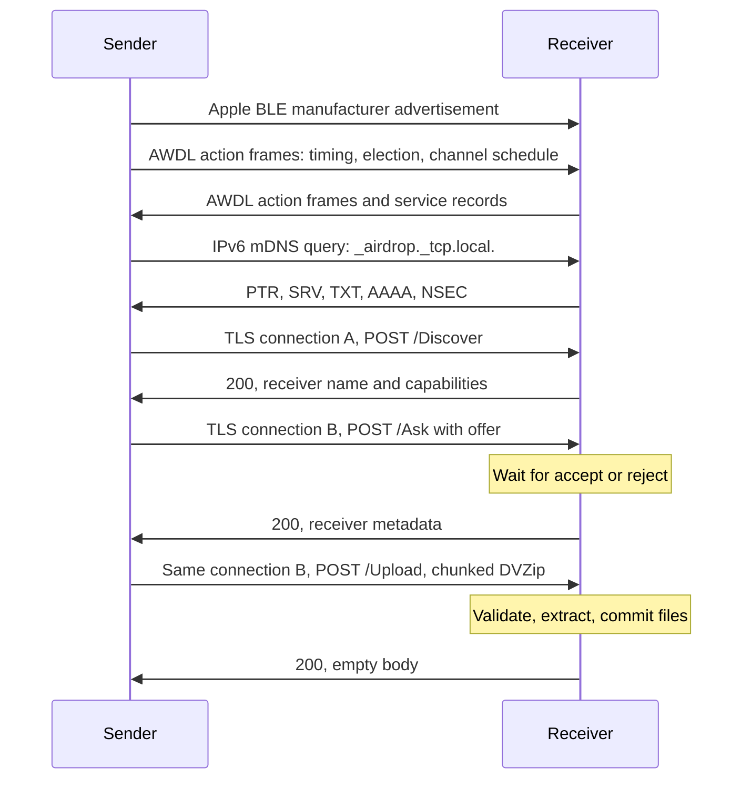

# AWDL and AirDrop protocol implemented by owl_rs

This document describes the wire formats and behavior implemented in this
repository. It is based on the patched C OWL implementation, the original
omdrop Python application, and live Apple traffic. It is a reverse-engineered
implementation contract, not an Apple specification. Constants and workarounds
below describe this implementation; they are not requirements for every Apple
release.

The application implements Everyone-mode AirDrop. It can publish an existing
verified Apple identity record, but does not obtain such a record, authenticate
incoming contacts, or enforce a Contacts Only receiver policy.

## Layers and transfer lifecycle



For a link offer, acceptance of `/Ask` completes the transfer; there is no
`/Upload`. Each CLI `send` or `receive` starts an operation-scoped AWDL, BLE,
discovery and HTTPS session. The daemon itself only listens on the local control
socket while idle. `receive` advertises its receiving service and answers discovery
queries, without browsing receivers or initiating outgoing transfers. `send`
activates these services while discovering and transferring to its target.

After success, failure, client disconnection or cancellation, the session stops
HTTPS, sends discovery goodbyes, unregisters BLE advertising, stops AWDL, removes
owned interfaces and restores saved WLAN settings. A successful `receive --once`
first flushes its final HTTP/TLS reply and holds the final TCP socket open in a
blocking worker with a ten-second linger bound, allowing data/FIN acknowledgments
while AWDL is still active. After HTTPS drains, the session keeps AWDL, BLE and
discovery active for another five seconds before cleanup (explicit cancellation
can end this grace period). This avoids tearing down the radio as soon as the
reply has merely reached the local TAP. Before removing the TAP,
controlled AWDL shutdown drains queued replies, TCP FINs and discovery goodbyes
until the transmit queue is empty and TAP traffic/injection has been quiet for
100 ms, bounded to two seconds if a peer becomes unavailable. An existing daemon
returns to idle; a temporary control service exits. `receive --once` completes on one
successful file or link transfer, drains its final HTTP response, then performs
this cleanup. Rejections and failed uploads do not count. Only one offer is
reserved at a time in this mode, so simultaneous peers cannot complete multiple
transfers before teardown.

## Radio context and IPv6

AWDL uses 802.11 frames with BSSID `00:25:00:ff:94:73`. The backend captures and
injects frames on a monitor interface and translates AWDL data to Ethernet on a
TAP interface. AirDrop runs over link-local IPv6 on that TAP. The link-local
address derives from the AWDL MAC using modified EUI-64: flip the universal/local
bit of the first byte and insert `ff:fe` between the MAC halves. The owned TAP is
created down, assigned this address with `nodad`, and then brought up. DAD is
disabled only on this temporary interface; no global setting is changed. Session
startup still verifies that the expected address is usable before binding HTTPS.
IBSS readiness and address readiness are polled at 50 ms intervals.

All link-local socket addresses need an interface scope. For example,
`[fe80::200:ff:fe00:1%3]:8770` uses an example link-local address and
interface index 3. Indices can change when a TAP is recreated. HTTPS sockets bind to that interface and the local
link-local address. mDNS and keepalives are injected as Ethernet frames on the
TAP so they do not depend on host VPN policy routing.

The TAP MTU is **1450**, matching C OWL. Ethernet-to-AWDL encapsulation adds LLC,
AWDL and 802.11 headers. Using MTU 1500 caused injection failures during TLS
uploads on the tested MT7612U. TAP packet offloads remain disabled.

Radio operations use `wl-nl80211` and `rtnetlink` directly, with bounded
requests and kernel acknowledgments. Capability and regulatory checks decode
nl80211 attributes; AP association is read from cached BSS status without
triggering a scan. Monitor flags use the kernel's nested nl80211 attribute,
including the active-monitor flag for hardware ACKs. Interface state/MAC,
link-local IPv6 address scope and `NODAD`, address readiness, and permanent
neighbors use routing netlink. Operation-scoped connection tasks close during
cleanup. NetworkManager ownership and saved connection restoration still use
`nmcli`; `ip` and `iw` executables are not required.

The physical radio context is selected by the TOML profile:

| Backend | Channel context and ACKs | Capture/injection |
| --- | --- | --- |
| IBSS | `owlibss0`, fixed AWDL BSSID | Passive `owlmon0` |
| Active monitor | Active `owlmon0`; existing station supplies tuning context | Active `owlmon0` |

In active-monitor mode the existing station becomes a passive monitor with the
same MAC. Type and passive flags are set in one netlink request; a separate
flags update can be rejected by the driver. This is adapter setup, not an
additional AirDrop wire protocol.
Exclusive mode works without a connected AP. Discovery/negotiation and
transmission use separate channel settings; discovery defaults to 6.
The channel-sequence TLV advertises all 16 slots on the committed transmit
channel, including during temporary discovery visits. The synchronization
parameters' current-channel field describes the physical discovery or transmit
channel; the master-channel field retains the transmit channel.

An initial discovery window lasts three schedules (3.145728 seconds). As a
local master, the node then tunes to its preferred transmit channel. As a
follower, it ranks channels by the number of slots in its elected sync parent's
sequence. Only permitted AWDL social channels (6, 44, 149) are considered;
ties favor the configured preference and then the lower channel number. A
failed tune excludes that candidate for the session and selects the next one.
The advertised transmit channel changes only after successful kernel tuning;
injection pauses throughout an outstanding tune. No remaining candidate is an
operation error that triggers normal cleanup.

Ten seconds after a discovery window, a one-schedule discovery visit lets new
peers negotiate when the session is idle. Pending unicast, unicast traffic in the previous
two seconds and shutdown draining defer these visits. Discovery visits send
action frames; Ethernet frames remain gated on the committed transmit channel
and the destination peer's matching slot. IBSS retunes its channel context by
leaving/rejoining the fixed-BSSID network and polling readiness. Active monitor
uses an acknowledged kernel channel-setting operation. Shared mode requires a
connected AP on channel 6, 44 or 149 and advertises the intersection with that
channel; it does not use separate-channel discovery or adaptive retuning. Driver/regulatory limits
still apply. See [radio profiles](../profiles.toml) and [usage](../README.md).

## AWDL action frames

Radiotap precedes the captured or injected 802.11 frame. Action frames use frame
control `0x00d0`; ordinary injected data uses `0x0008`. Addresses are destination,
source and the AWDL BSSID, followed by the 12-bit 802.11 sequence number shifted
left by four. Fragmented, protected and DS frames are ignored by this backend.

An AWDL action body begins with:

| Field | Bytes / encoding |
| --- | --- |
| Vendor category | `7f` |
| Apple OUI | `00 17 f2` |
| Type / version | `08 10` |
| Subtype | `00` periodic synchronization frame; `03` master indication frame |
| Reserved | `00` |
| Two timestamps | Two little-endian 32-bit microsecond values |
| TLVs | Repeated type `u8`, length little-endian `u16`, value |

The implemented TLVs include:

| Type | Purpose | Relevant behavior |
| --- | --- | --- |
| 2 | Service response | AirDrop PTR/SRV/TXT records appended to outgoing MIFs |
| 4 | Synchronization parameters | Next-slot timing, availability counter, channel and master |
| 5 | Election parameters | Legacy height, master and metrics |
| 18 | Channel sequence | Sixteen slots; simple, legacy or operating-class encoding |
| 24 | Election parameters v2 | Master/sync MACs, counter, height, metrics and self counter; preferred over v1 |
| 16 | ARPA name | Bounded hostname, advertised in MIFs |
| 21 | Version/device class | Needed with a MIF to mark a peer valid |
| 6, 7, 12 | Compatibility fields | Emitted using the inherited OWL shapes; not fully interpreted |

Unknown TLVs are skipped using their checked lengths. The whole action frame is
parsed before peer state changes, so a malformed trailing TLV cannot partially
update timing or election state. Incoming service-response TLVs are currently
not used to resolve peers; IP mDNS and scoped HTTPS probing perform resolution.

One time unit (TU) is 1024 microseconds. This backend uses 16-TU availability
windows, four windows per 64-TU slot, and 16 slots per schedule. Channel 0 means
unavailable. Sequence encoding has prefix `0f <encoding> 00 03 ff ff`, followed
by 16 one- or two-byte entries. Encoding 0 stores a channel byte; encoding 1
uses the second byte for the channel; encoding 3 stores channel then operating
class. Local fixed sequences use `51` for channel 6 and `80` for 44/149.

Counters wrap at 16 bits. Clock calculations use signed phase and wrapping
arithmetic to handle rollover and peers whose epoch precedes the local epoch.
Election normally ranks counter before metric; exclusive mode ranks metric
before counter, matching the patched C helper. Eligible parents must have tree
height below 10 and must not point back to this device as their sync parent.

Local election metric and counter default to 60 and 0. Experimental
`--election-metric` and `--election-counter` overrides set both the candidate's
self fields and its initial advertised master fields. They remain available
when a peer expires or the node returns to being its own master. The configured
election counter is fixed and separate from the wrapping availability-window
counter; Apple-style election-counter aging is not implemented. A larger local
rank does not prove that a peer has adopted this master or expanded its channel
availability. Check the peer's incoming election and channel-sequence TLVs.

The service uses `pin` plus an adaptive fixed transmit channel in exclusive mode, and
`intersect` in shared mode. Raw mode also exposes `verbatim`, `rotate` and
`widen`. A fixed physical channel does not remove unicast scheduling: unicast
still waits for a valid peer's matching channel slot, with boundary guards.
Fixed mode relaxes multicast scheduling. Runtime scheduling requests ticks every
500 microseconds (Tokio/OS timer resolution applies);
periodic synchronization frames are spaced 110 TU apart and MIFs are scheduled
around slot midpoints.

## AWDL data encapsulation

After the 802.11 header, a single data payload is:

```text
LLC/SNAP: aa aa 03 00 17 f2 08 00
AWDL marker: 03 04                  # little-endian 0x0403
AWDL sequence: <u16 little-endian>
Reserved: 00 00
EtherType: 86 dd                    # big-endian IPv6
IPv6 packet: ...
```

The decoder also accepts a zero SNAP OUI with the AWDL protocol ID. For QoS
A-MSDU, each subframe has destination MAC, source MAC, big-endian payload length,
and this LLC/AWDL payload; subframes align to four bytes. The decoder limits an
aggregate to 64 subframes and checks every length before copying.

The backend only forwards multicast or locally addressed data from valid peers.
802.11 retry duplicates are tracked for 500 ms with 128 sequence entries per
peer. Peer state is bounded to 512 entries and expires after five seconds without
valid action or data traffic. Fully parsed data from an already valid peer,
including a suppressed retry, refreshes its lifetime. Data cannot discover a new
peer or make an invalid peer valid, and malformed frames cannot refresh one.
Outgoing packets wait in a bounded queue with expiry instead of
accumulating indefinitely when no matching radio slot exists.

For nonblocking radio injection, `EAGAIN` and `ENOBUFS` mean temporary driver
backpressure. The runtime preserves the queued Ethernet frame, encoded AWDL
bytes and sequence numbers, yields to its event loop, and retries on a later
scheduler tick after rechecking the peer's channel slot. It does not block or
place frames in a separate driver queue that could transmit off-channel. The
original two-second packet expiry and 128-packet queue bound still apply.
Transmit counters increase only on success; `tx_backpressure` counts deferred
data injection attempts. Other injection errors remain failures with normal
session cleanup. These changes adapt
[omdrop-owl PR #11](https://github.com/t4t5/omdrop-owl/pull/11).

Radiotap selects a validated legacy or MCS data rate; action frames use 12 Mbps.
Fixed-radio unicast injection requests NOACK, inherited from the C patch. This
transmit setting is distinct from the radio backend's hardware reception ACKs.
FCS presence and radiotap padding are handled explicitly.

## Bluetooth wake-up

BlueZ advertising is owned by `bluer`. The Apple manufacturer ID is `0x004c`;
its 20-byte manufacturer payload is:

```text
05 12 40 <tag:3> 00 00 00 00 03 <hash-prefixes:8> 00
```

`05` is the AirDrop TLV type and `12` its 18-byte body length. The three-byte tag
is generated per advertising session and also sent as `SenderIdentityAuthTag`
in outgoing `/Ask`. A 100 ms advertising interval is requested. The precise
meaning of all reserved bytes is not established here; the shape matches the
existing helper. Zero hash prefixes are used for a self-signed Everyone identity.

With an optional verified Apple record, the current implementation fills up to
four two-byte slots from validated email hashes followed by validated phone
hashes. It does not implement every slot convention observed on Apple devices.
Advertising is unregistered on shutdown, and an adapter powered on by the session
is restored to its previous power state.

## Service discovery

The local service identifier is the AWDL MAC as 12 lowercase hexadecimal digits.
An active session publishes:

| DNS record | Value | Advertised TTL |
| --- | --- | --- |
| PTR `_airdrop._tcp.local.` | `<id>._airdrop._tcp.local.` | 4500 s |
| SRV `<id>._airdrop._tcp.local.` | Priority/weight 0, HTTPS port, `<id>.local.` | 120 s |
| TXT service instance | `flags=137` | 4500 s |
| AAAA `<id>.local.` | Local link-local IPv6 | 120 s |
| NSEC hostname | AAAA and NSEC bitmap | 120 s |

`137` is `0x89`; bit `0x80` indicates Discover support and bit `0x01` supports
links in the inherited implementation. The remaining bit is preserved without
assigning an undocumented meaning. NSEC tells Apple's resolver that an IPv4 A
record is absent; omitting it delayed or prevented visibility in live testing.
Unique records use the mDNS cache-flush bit.

mDNS uses UDP port 5353, multicast IPv6 `ff02::fb`, Ethernet destination
`33:33:00:00:00:fb`, and hop limit 255. Received messages must have a link-local
source and hop limit 255. Replies are rate-limited. The current helper-compatible
cadence sends an approximately one-second announcement burst every three
seconds, with discovery queries during each burst. TTL-zero records are sent on
graceful shutdown. DNS address, service and TXT caches are bounded and retained
for at most 120 seconds locally, even when the advertised TTL is longer.

AWDL service-response TLVs use Apple's fixed DNS compression dictionary rather
than packet-relative mDNS compression. The outgoing implementation uses `c0 07`
for the AirDrop service, `c0 0c` for `.local`, and `c0 00` as the PTR terminator.
Each type-2 TLV contains little-endian owner-name length, encoded owner, DNS type
byte, little-endian RDATA length, two reserved bytes and RDATA. SRV priority,
weight and port remain big-endian DNS fields. These records complement mDNS;
publishing only IPv6 mDNS was insufficient for receiver visibility in testing.

An active session also sends a scoped unicast ICMPv6 echo to each valid AWDL neighbor
roughly every three seconds. This stimulates neighbor learning on Apple peers.
It is a compatibility mechanism, not a new AirDrop application message.

For name selection, the sender resolves `/Discover` concurrently, bounded to
eight probes. A valid AWDL neighbor that has not published mDNS is also tried at
its EUI-64 link-local address on port 8770. This is an Apple-port assumption,
not proof that every AWDL neighbor offers AirDrop; only a successful Discover
response makes such a fallback candidate visible as an AirDrop peer. A direct
scoped address can override discovery.

## TLS and HTTP

AirDrop uses HTTP/1.1 over TLS. The Rust implementation supports TLS 1.2 or newer
and handles TLS through Tokio/OpenSSL. It generates a private RSA-2048 key and
self-signed certificate when no identity exists. Everyone-mode TLS certificates
are not checked against public Web PKI; this supplies transport encryption, not
Apple-account authentication or protection against an active impostor.

An optional `validation_record.cms` must have a valid Apple-root signature, a
matching Apple-issued certificate chain, and account CN
`com.apple.idms.appleid.prd.<altDsID>`. That validates the local identity being
published. The receiver does not treat an incoming record as an authenticated
contact. An ambient Contacts Only Mac rejected the self-signed client during
live tests; enabling Everyone on the target iPhone was necessary.

Requests are POSTs. Metadata is a binary plist; current outgoing metadata uses
`Content-Type: application/octet-stream`. Content-Length and chunked incoming
metadata are both accepted. Apple uses chunked framing in observed replies and
requests, so metadata is read to the HTTP body end, not a presumed length.
Metadata is limited to 1 MiB with a 20-second frame idle timeout.

### Discover

The sender opens a connection and posts `/Discover` with:

```text
DeviceSupportFlags = 111611
SenderRecordData = <CMS bytes>             # optional
```

A successful response supplies `ReceiverComputerName`. The local receiver emits:

```text
ReceiverComputerName = <configured name>
ReceiverModelName = "MacBookPro18,3"
ReceiverMediaCapabilities = <JSON bytes: {"Version": 1}>
ReceiverRecordData = <CMS bytes>           # optional
```

The minimal media-capability value follows the original helper and asks Apple
to choose legacy-compatible media; it is not a claim of HEIF/HEVC codec support.

### Ask and approval

The sender opens a fresh TLS connection for `/Ask`, retaining that connection
for `/Upload`. The offer includes:

| Key | Current outgoing value |
| --- | --- |
| `TransferID` | Dictionary containing `id`: uppercase UUID |
| `TransferType` | `{"files": {}}` or `{"links": {}}` |
| `SenderID` | Local 12-hex service ID |
| `BundleID` | `com.apple.finder` |
| `SenderComputerName`, `SenderModelName` | Configured name, `MacBookPro18,3` |
| `Files` | Per-file dictionaries, or empty for links |
| `Items` | URL strings for links; otherwise empty |
| `ConvertMediaFormats` | false |
| `SenderIdentityAuthTag` | Three-byte current BLE tag, when advertising |
| `SenderRecordData` | Optional CMS record |
| `FileIcon` | Optional JPEG thumbnail |

Each file dictionary contains `FileName`, `FileBomPath` (`./<basename>`),
`FileSize`, `FileIsDirectory`, `FileType` and `ConvertMediaFormats=false`.
UTIs cover JPEG, PNG, HEIC, MP4, MOV, PDF, text and folders; unknown extensions use
`public.data`. A PNG/JPEG preview is bounded, resized to at most 240×240, and
JPEG-encoded at quality 80.

The receiver also accepts a string UUID in `TransferID`. File names must be
basenames; absent FileSize is treated as unspecified. Offers are bounded to
4096 files or links; mixed or empty offers are rejected. URL strings are bounded
and cannot contain newline, carriage return or NUL.

By default the offer becomes `pending` for at most 60 seconds. Local
`accept TRANSFER_ID` authorizes it; rejection/expiry returns HTTP 403.
`--auto-accept` bypasses this decision explicitly. Acceptance returns HTTP 200
with the receiver metadata used by Discover. Authorization is stored on this
TLS connection; knowing the UUID on another connection does not authorize an
upload. Links are written as inert `.url` files when Ask is accepted.

### Upload and completion

The file sender posts `/Upload` on the accepted Ask connection:

```http
POST /Upload HTTP/1.1
Content-Type: application/x-dvzip
TransferID: <same uppercase UUID>
TotalBytes: <sum of offered file sizes>
Transfer-Encoding: chunked
```

The receiver checks the transfer ID against the connection's accepted offer and
consumes that authorization once. It accepts DVZip and octet-stream uploads,
with gzip-wrapped CPIO supported by the decoder. `TotalBytes` is informational;
actual wire and expanded bytes are bounded independently. The whole upload has
a ten-minute deadline, with a 20-second stall limit.

A successful upload returns **HTTP 200 with an empty body**, without a plist
Content-Type, and with `Connection: close`. Completing this upload's connection
lets the sender finish without waiting for the server's idle-header timeout;
the receiving session can continue on other connections. `receive --once` drains
this final reply before tearing down AWDL.

An earlier keep-alive reply left the connection open for 20 seconds after a
2,041,711-byte JPEG had been committed. The phone showed a finishing delay.
Closing the completed connection while retaining the empty, untyped reply was
then tested with an 8,727,870-byte MOV, which the phone reported as Sent. Earlier
Content-Type and keep-alive changes were tested together; this comparison
preserves the body and Content-Type behavior while changing connection closure.

Some captured iPhone transfers delivered a complete archive without finishing
the HTTP chunk terminator. After two seconds of inactivity, Rust attempts full
archive validation against the accepted offer. Only a complete, matching archive
is committed and acknowledged; that exceptional connection is then closed. If
validation fails, reception can continue until the stall deadline. Validation
runs once per received byte count during a quiet period. Hyper retains partial
chunk headers and body data across short timed waits. The decoded CPIO must have
at least one member and a structurally parsed, zero-size `TRAILER!!!` entry;
an empty upload, an archive cut between members or a trailer string inside file
data cannot complete it. All approved files and sizes must still match.

This is the same recovery principle as
[omdrop-plugin PR #41](https://github.com/brentkearney/omdrop-plugin/pull/41).
The missing HTTP zero chunk is framing, rather than file data: no missing file
bytes are invented or accepted. The focused HTTPS regression pauses inside a
chunk-size line and inside a chunk body, then sends a complete archive without
the closing zero chunk and requires an empty 200 reply and session teardown.

A saved file alone is not sufficient evidence of protocol success. Verification
requires the sender to receive its final HTTP success and the phone to finish
without changing to Failed.

## DVZip and CPIO

DVZip is a sequence of length-prefixed blocks:

```text
<u32 big-endian block header> <block bytes>
```

The high bit means a stored, uncompressed block. The lower 31 bits give the
following byte count. Without the high bit, the block is a complete zlib stream,
including checksum. Rust emits blocks from 64 KiB of CPIO input, using zlib
level 6 when compressed data is smaller, otherwise a stored block. There is no
separate DVZip end marker in this implementation; HTTP body completion and the
CPIO trailer delimit the transfer.

Apple's compressed blocks may expand to more than the decoder's 64 KiB output
buffer. Decompression must continue until zlib StreamEnd, verify all compressed
bytes were consumed, and reject truncated streams or trailing compressed data.
Using FlushDecompress::Finish with a limited output buffer rejected valid Apple
blocks; streaming with FlushDecompress::None fixed the captured archive.

Outgoing archives use portable ASCII/ODC CPIO (`070707`). Each member has a
76-byte ASCII header, a NUL-terminated name, and file data. Names are
`./<basename>` or `./<folder>/<relative path>`. **Regular file names must not have
a trailing slash.** A live iPhone reset Rust's upload when the file was encoded
as `./photo.png/`; correcting that path made the same transfer succeed.
Directories use mode `040755`, files `100644`, and members end with
`TRAILER!!!`. No symlinks, special files or hard-link entries are sent.

Receiving supports ODC and new ASCII CPIO (`070701`, four-byte alignment).
Preflight bounds names, sizes and member count before the archive library reads
members. Extraction rejects absolute/traversing paths, backslashes, NULs,
duplicate members, symlinks, special files and hard links. It stages privately
and atomically renames the completed transfer directory. Approved top-level
files must be present with matching types and specified sizes.

Apple may add `._<filename>` AppleDouble metadata. Such companions are allowed
only for an approved file, with size 26 bytes to 1 MiB and header
`00 05 16 07 00 02 00 00`. This checks the magic/version, not every AppleDouble
entry's semantics. Companions are retained as received rather than applied as
extended attributes.

The default receive limit is 4 GiB. At upload start, the effective budget is the
smaller of that limit and one twelfth of available output-disk bytes, allowing
for four concurrent uploads and their wire, decoded and extracted data. There
are at most 32 HTTPS connections, four uploads and 256 transfer records. These
are implementation limits configurable or revisable independently of the wire
protocol.

## Local daemon control protocol

This is an owl_rs protocol, not an Apple protocol. A Unix socket at
`<run-dir>/control.sock` has mode 0600; peer credentials restrict clients to the
daemon owner or root. A connection sends one newline-terminated JSON command,
limited to 1 MiB, then receives one newline-terminated result:

```json
{"command":"transfers"}
{"ok":[{"offer":{"id":"...","sender":"Example Phone","items":[],"urls":[]},"state":"pending","bytes":0,"output":null,"error":null}]}
```

Commands are `status`, `peers`, `transfers`, `accept`, `reject`, `cancel`, `stop`,
`receive` and `send`. `accept`/`reject` use an incoming transfer UUID; `cancel`
uses the active `session.id` listed by status. Idle status has `session: null`.
An active session reports its ID, `kind` (`send` or `receive`) and `phase`
(`starting` or `active`). Transfer history remains available after teardown.
`peers` requires an active send session; it does not activate an idle radio.
Errors use `{"error":"message"}`.

Before starting a foreground operation, the CLI probes the control socket.
A missing socket or connection refusal starts a standalone control service;
other connection errors are reported. Startup takes an exclusive daemon lock
before replacing an orphaned socket. Radio recovery uses the journal in the
same run directory, so restarting with a different directory does not recover
interfaces from the interrupted session.

A foreground receive request is held open for the session's lifetime:

```json
{"command":"receive","once":true,"options":{"auto_accept":true}}
```

Session `options` contain explicit CLI overrides for typed daemon defaults;
radio fields are nested under `radio`. Unknown fields and invalid enum/rate
values are rejected. The run directory and owning UID must match the control
service. Omitted options inherit the daemon's configuration; its lifetime
`duration` is not inherited as a session timeout. The same overrides are
available on `send`.

A second session request fails while one is active. Closing the initiating
client's connection cancels its session, but the restoration task continues
independently of that connection. CLI Ctrl+C closes this connection and waits
for idle status. Normal completion replies only after setup has been torn down.

For `send`, the JSON declares `to`, optional scoped `direct`, `items`, `urls`,
`bytes`, optional thumbnail `icon`, and discovery `timeout`. Exactly `bytes` raw
archive bytes follow the newline for a file transfer. The client builds the
archive; the privileged daemon does not interpret a client-supplied source path.
`stop` acknowledges before triggering shutdown so the client does not see an
unexpected EOF; the daemon waits for any active session's restoration before
exiting.

## Observed interoperability and remaining scope

MT7612U/mt76x2u active-monitor tests completed native Rust image transfers in
both directions, including name-based sending. Large image and approximately
8 MiB video receives completed with matching offered sizes and valid media.
The original Python sender/receiver and Rust also interoperated in local HTTPS
tests for files, folders and links. Focused tests cover malformed frames,
timing rollover, encapsulation, archive bounds and connection-bound consent.
The HTTPS regression uses an 8 MiB incompressible synthetic file.

Early channel-6 video uploads took roughly 90–115 seconds. Captures showed
off-channel intervals and TCP retransmissions. Separating discovery on 6 from
transmission on 149 at HT20 improved one comparable video receive to about
35 seconds. The phone reported successful completion, and captured TCP traffic
confirmed channel 149. Throughput remains dependent on the radio environment
and advertised peer schedule.

The bounded TCP drain and five-second grace period allowed final success-reply
and FIN acknowledgments before teardown. Sessions then removed owned
AWDL/monitor interfaces, restored managed WLAN and unregistered BLE advertising.
Normal HTTP termination and recovery from missing termination are separately
verified; incomplete archives remain rejected.

Native Rust IBSS/shared-mode AirDrop, Contacts Only policy, Apple identity
acquisition, broad OS-version compatibility and all media conversions are not
validated or implemented by this evidence. A different phone failing to see a
receiver is not automatically an identity problem: the exclusive schedule,
service TLVs, NSEC, BLE presence and neighbor learning all affect visibility.

## Source map

| Area | Source |
| --- | --- |
| Frame encoding/decoding, service TLVs | [protocol.rs](../src/protocol.rs) |
| Clock and channel sequence | [channel.rs](../src/channel.rs) |
| Election, peer validity, traffic scheduling | [engine.rs](../src/engine.rs) |
| Capture, TAP, neighbor and radio workers | [runtime.rs](../src/runtime.rs) |
| Adapter profiles and restoration | [radio.rs](../src/radio.rs) |
| BLE wake advertisement | [ble.rs](../src/ble.rs) |
| mDNS and scoped discovery candidates | [discovery.rs](../src/discovery.rs) |
| Certificates and optional Apple record | [identity.rs](../src/identity.rs) |
| HTTPS Discover/Ask/Upload | [transfer.rs](../src/transfer.rs) |
| Archive encoding, validation and extraction | [archive.rs](../src/archive.rs) |
| Lifecycle and local control socket | [service.rs](../src/service.rs) |
