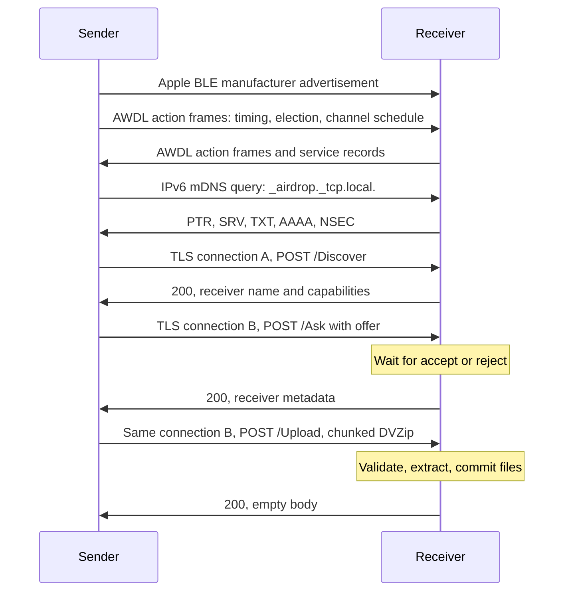

# AWDL and AirDrop protocol implemented by owl_rs

This document describes the wire formats and behavior implemented in this
repository. It is based on the patched C OWL implementation, the original
omdrop Python application, and live Apple traffic. It is a reverse-engineered
implementation contract, not an Apple specification. Constants and workarounds
below describe this implementation; they are not requirements for every Apple
release.

The application sends to Everyone-mode recipients and receives in Everyone or
Contacts Only mode. A receiver may publish an existing verified Apple identity
record; obtaining that record and Contacts Only sending are not implemented.

## Layers and transfer lifecycle



For a link offer, acceptance of `/Ask` completes the transfer; there is no
`/Upload`. CLI sends and BLE wake requests activate or reuse one bidirectional
session. Idle daemons expose a local control socket and, when receiving is
enabled, an LE advertisement listener. Runtime
`discoverable everyone|contacts|off` controls incoming advertising and
authorization; it starts
as `off` and is not persisted across daemon restarts.

`owld` owns the radio and TAP; `airdropd` owns transport, discovery and identity.
Authenticated Unix IPC leases the link and acknowledges transfer-channel readiness
before `/Upload`. See [Architecture](architecture.md) for IPC, privilege separation
and restoration, and [Usage](usage.md#sessions-and-the-daemon) for controls.

Outgoing operations, peer browsing and active incoming HTTPS requests hold
session leases through reply and TCP drain. Idle discovery sockets release their
leases after answering. CLI disconnect cancels only its send; session cancellation,
stop and signals interrupt all work.

Eligible BLE wakes reset the idle deadline (default 120 seconds), including during
completion grace. After successful work and the last lease release, the session
holds the link and advertisements for `--completion-grace` (default five seconds).
New work can join then; acquisition during shutdown waits for restoration.
See [Bluetooth wake-up](#bluetooth-wake-up) for wake admission.

Successful file/link connections flush their reply and close a final TCP descriptor
in a blocking worker with a ten-second linger bound. Refusals and failures skip
this success-only linger. Completion grace starts after TCP drain, not a TAP write.

Teardown stops transport, sends mDNS goodbyes and unregisters BLE advertising.
The radio drains queued replies, FINs and goodbyes until traffic is quiet for
100 ms, bounded to two seconds, then removes owned interfaces and restores WLAN.
The user daemon returns to idle.

## Radio context and IPv6

AWDL uses 802.11 frames with BSSID `00:25:00:ff:94:73`. The backend captures and
injects frames on a monitor interface and translates AWDL data to Ethernet on a
TAP interface. AirDrop runs over link-local IPv6 on that TAP. The link-local
address derives from the AWDL MAC using modified EUI-64: flip the universal/local
bit of the first byte and insert `ff:fe` between the MAC halves. The owned TAP is
created down, assigned this address with `nodad`, and then brought up. DAD is
disabled only on this temporary interface; no global setting is changed. Session
startup verifies that the expected address is usable before binding HTTPS.
IBSS readiness and address readiness are polled at 50 ms intervals.

IPv6 sockets bind to the leased interface and link-local address. Addresses need
an interface scope, such as `%3` in `[fe80::200:ff:fe00:1%3]:8770`; indices can
change when the TAP is recreated. The kernel encapsulates TCP and UDP, while the
radio layer generates neighbor-learning ICMP probes. Host routing and filtering
apply; the application adds no firewall or VPN exceptions.

The TAP MTU is **1450** with packet offloads disabled. Session-owned
monitors request MTU 8192 through rtnetlink so packet sockets can accept larger
A-MSDUs. If that request is rejected, batching respects the reported monitor
MTU; raw diagnostics use the prepared interface's current MTU. The owned
monitor is deleted during teardown, so no persistent interface MTU changes.
The monitor MTU bounds the full injected frame, including radiotap and 802.11
headers.

Radio operations use `wl-nl80211` and `rtnetlink` directly, with bounded
requests and kernel acknowledgments. Capability and regulatory checks decode
nl80211 attributes; AP association is read from cached BSS status without
triggering a scan. Monitor flags use the kernel's nested nl80211 attribute,
including the active-monitor flag for hardware ACKs. Interface state/MAC,
link-local IPv6 address scope and `NODAD`, address readiness, and permanent
neighbors use routing netlink. Operation-scoped connection tasks close during
cleanup. NetworkManager ownership and saved connection restoration use
`nmcli`; `ip` and `iw` executables are not required.

[Radio profiles](radio.md#modes-and-backends) select IBSS or active-monitor
context in exclusive mode, which works without an AP. Active-monitor setup
converts the station to a passive monitor with the same MAC, setting type and
flags in one netlink request because drivers may reject a separate flags update.
In exclusive mode, the daemon stays on `--primary-channel 6|44|149` (default 149)
and advertises that channel in all 16 slots throughout the active session.
Peer schedules and activity changes do not replace it. Clock synchronization
still follows the elected sync parent.

The advertised width reflects successful tuning. Synchronization channel fields
describe the selected physical channel. Injection pauses during an outstanding
tune; Ethernet frames require the destination peer's matching slot and boundary
guards. The selected channel must pass driver/regulatory checks before setup;
a tuning failure triggers cleanup.
Shared mode stays on the AP's current channel and advertises that channel in all
16 slots, with the AP's width; it ignores the primary-channel preference.
IBSS changes channel by leaving/rejoining the fixed-BSSID network; active monitor
uses acknowledged kernel channel-setting operations.
See [radio profiles](../profiles.toml) and [radio configuration](radio.md).

## AWDL action frames

Radiotap precedes the captured or injected 802.11 frame. Action frames use frame
control `0x00d0`; ordinary injected data uses `0x0008`. Addresses are destination,
source and the AWDL BSSID, followed by the 12-bit 802.11 sequence number shifted
left by four. Fragmented, protected and DS frames are ignored by this backend.

An AWDL action body begins with:

| Field | Bytes / encoding |
| --- | --- |
| Vendor category | `7f` |
| Apple OUI | `00 17 f2` |
| Type / version | `08 10` |
| Subtype | `00` periodic synchronization frame; `03` master indication frame |
| Reserved | `00` |
| Two timestamps | Two little-endian 32-bit microsecond values |
| TLVs | Repeated type `u8`, length little-endian `u16`, value |

The implemented TLVs include:

| Type | Purpose | Relevant behavior |
| --- | --- | --- |
| 2 | Service response | AirDrop PTR/SRV/TXT records appended to outgoing MIFs |
| 4 | Synchronization parameters | Next-slot timing, availability counter, channel and master |
| 5 | Election parameters | Legacy height, master and metrics |
| 18 | Channel sequence | Sixteen slots; simple, legacy or operating-class encoding |
| 24 | Election parameters v2 | Master/sync MACs, counter, height, metrics and self counter; preferred over v1 |
| 16 | ARPA name | Bounded hostname, advertised in MIFs |
| 21 | Version/device class | Needed with a MIF to mark a peer valid |
| 7 | HT capabilities | Hardware HT flags, A-MPDU parameters and RX MCS mask, emitted in PSFs and MIFs |
| 17 | IEEE 802.11 container | Hardware VHT Capability IE, emitted in MIFs when supported by the current band |
| 6, 12 | Compatibility fields | Emitted using the inherited OWL shapes; not fully interpreted |

Before live operation, nl80211 supplies separate 2.4 and 5 GHz capabilities from
the selected PHY. Split wiphy dump messages are merged by band. Each MIF uses
the capabilities of its physical channel; absent or incomplete capabilities are
omitted rather than replaced with a fixed device profile. Offline replay does
not query hardware.

HT type 7 contains two reserved bytes, the little-endian HT capability word,
one A-MPDU parameter byte, a variable RX MCS mask, and two reserved trailing
bytes. The receiver retains the first four mask bytes (MCS 0–31) and ignores
higher bits in extended masks. Local advertisements emit one to four mask
bytes. VHT type 17 wraps standard IE 191: length 12, little-endian capability
word and the eight-byte RX/TX MCS/NSS set. These layouts
follow the [Wireshark AWDL dissector](https://github.com/wireshark/wireshark/blob/master/epan/dissectors/packet-awdl.c).
Capability flags describe hardware support. Active-monitor transfer tuning tries
widths up to `--max-bandwidth` (default 40 MHz) on 5 GHz, constrained by the
PHY's HT/VHT capabilities and regulatory flags on every constituent 20 MHz channel. Kernel rejection falls
back to narrower definitions on the same primary. Channel 6 uses 20 MHz; shared mode
preserves the AP's width and center frequency, and IBSS uses HT20.

SetWiphy supplies primary frequency, width and center frequency together. After
its ACK, GetInterface checks the requested definition when the kernel reports
one. mac80211 can omit this readback when active and passive monitors coexist
without a per-interface channel context; in that case the ACK establishes the
applied definition. A reported mismatch is rejected. Both synchronization and
channel-sequence TLVs then describe that confirmed context. AWDL's operating-class encoding retains the primary channel
number: class 128 for 80 MHz, 116/126 for HT40+ on 44/149, and 115/124 for HT20
on 44/149. Channel 6 uses class 81. Width changes preserve unavailable slots.
`status` exposes the confirmed `physical_channel_definition`; it is null while
tuning is in flight. These netlink channel definitions follow
[Linux cfg80211](https://github.com/torvalds/linux/blob/master/net/wireless/chan.c).

Unknown TLVs are skipped using their checked lengths. Zero-filled suffix
padding is accepted at action TLV boundaries, including one or two bytes left
after zero-length tag-0 records. A nonzero incomplete header or a truncated
declared value is invalid. Unsupported optional VHT IE layouts and ARPA
label encodings are skipped without discarding timing and availability; a
compressed ARPA label without a preceding literal does not supply a hostname.
The whole action frame is parsed before peer state changes, so a malformed
trailing TLV cannot partially update timing or election state. Incoming
service-response TLVs are currently not used to resolve peers; IP mDNS and
scoped HTTPS probing perform resolution.

One time unit (TU) is 1024 microseconds. This backend uses 16-TU availability
windows, four windows per 64-TU slot, and 16 slots per schedule. Channel 0 means
unavailable. Sequence encoding has prefix `0f <encoding> 00 03 ff ff`, followed
by 16 one- or two-byte entries. Encoding 0 stores a channel byte; encoding 1
uses the second byte for the channel; encoding 3 stores channel then operating
class. Local fixed sequences use `51` for channel 6 and `80` for 44/149.

Action-frame synchronization subtracts the wrapping 32-bit difference between
PHY and target transmit timestamps from capture time. Live capture explicitly
uses host microsecond timestamps mapped to the runtime's monotonic epoch, so
userspace queueing does not shift the AWDL clock. Invalid capture timestamps
fall back to processing time; a detected wall-clock offset change over 10 ms
disables capture-time mapping for the session. Outgoing action frames retain
the construction timestamp and update the PHY timestamp immediately before
injection. USB/driver receive latency and post-injection transmit delays are
unmeasured; these are not hardware on-air timestamps.

Counters wrap at 16 bits. Clock calculations use signed phase and wrapping
arithmetic to handle rollover and peers whose epoch precedes the local epoch.
Election normally ranks counter before metric; exclusive mode ranks metric
before counter, matching the patched C helper. Eligible parents must have tree
height below 10 and must not point back to this device as their sync parent.

Local election metric and counter default to 60 and 0. Experimental
`--election-metric` and `--election-counter` overrides set both the candidate's
self fields and its initial advertised master fields. These values persist
across peer expiry and transitions to self-master. The configured
election counter is fixed and separate from the wrapping availability-window
counter; Apple-style election-counter aging is not implemented. A larger local
rank does not prove that a peer has adopted this master or expanded its channel
availability. Check the peer's incoming election and channel-sequence TLVs.

The service uses fixed `pin` in both modes. Raw diagnostics also expose
`intersect`, `verbatim`, `rotate`, and `widen`. Unicast waits for a valid
peer's matching channel slot, with boundary guards. Fixed mode allows
multicast in every slot, within its guarded airtime budget. Runtime scheduling requests ticks every
500 microseconds (Tokio/OS timer resolution applies);
periodic synchronization frames are spaced 110 TU apart and MIFs are scheduled
around slot midpoints.

## AWDL data encapsulation

A phone's initial TCP SYN can arrive before its validating MIF. Up to 128 bare
SYN/SYN-ACK packets addressed to the local AWDL MAC and IPv6 address are staged,
without creating or validating a peer. Retransmissions with the same peer,
ports and TCP sequence share one entry. Staged packets expire after
`--queued-packet-timeout` (default two seconds) and are released only when that
peer passes normal AWDL validation. Other early data is ignored; Contacts
Only authorization occurs independently at HTTPS. The `rx_syn_buffered`,
`rx_syn_released` and `rx_syn_expired` statistics expose these transitions.

After the 802.11 header, a single data payload is:

```text
LLC/SNAP: aa aa 03 00 17 f2 08 00
AWDL marker: 03 04                  # little-endian 0x0403
AWDL sequence: <u16 little-endian>
Reserved: 00 00
EtherType: 86 dd                    # big-endian IPv6
IPv6 packet: ...
```

The decoder also accepts a zero SNAP OUI with the AWDL protocol ID. For QoS
A-MSDU, each subframe has destination MAC, source MAC, big-endian payload length,
and this LLC/AWDL payload; subframes align to four bytes. The decoder limits an
aggregate to 64 subframes and checks every length before copying.

The backend only forwards multicast or locally addressed data from valid peers.
802.11 retry duplicates are keyed by QoS TID and sequence number, with a
separate non-QoS sequence space. The cache retains up to 128 entries per peer
for 500 ms by default, shared across TIDs. Peer state is bounded to 512 entries and by default expires after five seconds without
valid action or data traffic. Fully parsed data from an already valid peer,
including a suppressed retry, refreshes its lifetime. Data cannot discover a new
peer or make an invalid peer valid, and malformed frames cannot refresh one.
Outgoing packets wait in a bounded queue with expiry instead of
accumulating indefinitely when no matching radio slot exists.

For nonblocking radio injection, `EAGAIN` and `ENOBUFS` mean temporary driver
backpressure. The runtime preserves the queued Ethernet frame, encoded AWDL
bytes and sequence numbers, yields to its event loop, and retries on a later
scheduler tick after rechecking the peer's channel slot. It does not block or
place frames in a separate driver queue that could transmit off-channel. The
queue holds at most 128 packets, with a default two-second expiry.
Transmit counters increase only on success; `tx_backpressure` counts deferred
data injection attempts. Other injection errors fail the session and trigger
cleanup. This behavior adapts
[omdrop-owl PR #11](https://github.com/t4t5/omdrop-owl/pull/11).

### Transmit rates

[Rate selection](../crates/owl/src/rate.rs) resolves `auto` against local TX and peer RX
capabilities before frame encoding. The radiotap library's rate tables rank
candidates by PHY Mbps. HT20 requires a defined local TX set matching RX;
VHT also uses the peer's operating classes and acknowledged local channel
width. Static/dynamic SMPS peers are limited to one stream because injection
does not arrange RTS/CTS wake-up. Unsupported short GI becomes long GI.
VHT requests bound MCS, streams and width. A transmit-policy ceiling of MCS8
applies to automatic and explicit requests after MCS9 stalled injected
uploads. Advertisement and reception use the hardware capability maps. Missing
capabilities fall back to 12 Mbps. Actions and automatic/VHT multicast discovery
also use 12 Mbps.
CLI syntax and overrides are documented in [Radio configuration](radio.md#transmit-rates).

The codec rejects unresolved `auto` and invalid PHY rates. VHT radiotap field
21 has two-byte alignment, known GI/bandwidth, bandwidth code 0/1/4, and a
single user's MCS/NSS nibble pair with selected coding. Encoding follows the
[radiotap VHT specification](https://www.radiotap.org/fields/VHT.html) and
[mac80211 injection format](https://docs.kernel.org/networking/mac80211-injection.html).
Queued packets keep their 802.11/AWDL sequence numbers across backpressure;
retuning or capability changes refresh only the radiotap transmission header. The
encoder can combine queued packets in A-MSDUs as described below.

Unicast hardware ACK handling is independent of fixed-channel scheduling.
The driver profile's `tx_noack` workaround defaults to false and is overridden
with `--tx-ack normal|noack`. Injection also requests NOSEQNO so a matching
shared station cannot rewrite sequence numbers used for completion correlation.
The MT76x2U profile uses NOACK to avoid a driver TX-status cleanup stall after
channel changes; the Intel profile uses NOACK as a firmware workaround.
Incoming hardware reception ACKs are configured by the radio backend separately.

Radiotap TX_FLAGS plus DATA_RETRIES identify local driver completion reports.
They never enter TAP or refresh incoming peers. A bounded ledger correlates
successful unicast submissions using destination, 802.11 sequence and body
fingerprint; reports without a known PHY rate (including mt76 synthetic ACKs
after lost status), stale, duplicate, foreign and uncorrelated reports do not affect
rate selection. The queued-packet timeout bounds ledger age. Debug
logs include hardware outcome, retry count, requested/reported rate and latency.
USB completion padding is excluded using checked IPv6/A-MSDU lengths, preserving
zeros within application data. Radio cleanup also waits for pending completion
reports, bounded by the radio-drain and queued-packet timeouts.

`auto` starts at the shared capability ceiling. Four failures within a 32-frame
window, or at least two retries per frame after 16 reports, lower the target
PHY rate by at least 15% when a slower candidate exists. After 128 consecutive
successes without retries, it probes the next faster candidate. Late reports
from an older rate or channel cannot change the new selection. Explicit rates
are fixed. Capability/channel changes reset the candidate ladder. No feedback
is synthesized from capture gaps or successful packet injection. Missing driver
reports leave capability-based selection in place.
FCS presence and radiotap padding are handled explicitly.

### Block Ack negotiation

By default, `owld` declines IEEE 802.11 ADDBA requests addressed to its MAC by
validated AWDL peers with status 37. The experimental profile option
`rx_ampdu = true` enables acceptance on exclusive active-monitor backends with
`mon_mac = "station"`. It requires hardware/firmware that generates Block Ack
responses in this mode; userspace does not send these time-critical replies.

Acceptance negotiates immediate Block Ack, a window of at most 64 MPDUs,
A-MSDU-in-A-MPDU support, and an inactivity timeout of zero (disabled). There are at
most eight peer/TID agreements; a full table declines new agreements without
evicting existing ones. A response uses the management rate and configured
unicast ACK policy, shares data airtime/slot gating, and preserves its sequence
across injection backpressure. The session starts only after successful
submission. Repeated identical requests do not rewind it. The
queued-packet timeout expires stale responses. Listen-only diagnostics never
respond or establish agreements.

Accepted sessions deliver each decoded MPDU as a unit in 12-bit sequence order,
independently for each peer/TID. Old and duplicate MPDUs are discarded even
without a Retry bit. Frames ahead of the window advance it; a 100 ms gap timeout
releases held data without waiting indefinitely. The runtime polls independently
of channel tuning. Single-TID basic/compressed BARs advance the receive window;
multi-TID BARs are unsupported. Sender-initiated DELBA flushes and removes the
receive agreement and cancels queued responses; recipient-initiated DELBA does
not affect it. Peer expiry drops held data and pending responses. Shutdown waits
for buffered data within the radio drain budget.

Status includes `rx_reorder` counters for started sessions, buffered, duplicate
and old MPDUs, skipped sequences, gap timeouts and BARs. Acceptance/rejection
counts appear in `stats`. These describe local processing, not proof that hardware
sent a Block Ack or that the peer received our response. Offline replay does not
establish agreements because it cannot send acceptance responses.

### Transmit coding

The daemon defaults to LDPC; raw diagnostics default to BCC. Coding is resolved
per peer after the concrete rate is selected. HT checks RX LDPC capability bit
0; VHT checks RX LDPC bit 4. Local TX support is supplied by the selected driver profile
(`supports_tx_ldpc`, false when omitted), independently of local advertised RX
capabilities.

HT LDPC sets radiotap MCS HAVE_FEC and FEC_LDPC. VHT sets the user-0 coding bit.
The upstream [Linux 7.2.9 injection parser](https://github.com/gregkh/linux/blob/v7.2.9/net/mac80211/tx.c)
ignores that VHT coding byte, so VHT LDPC additionally includes a preceding
MCS field `[0x12, 0x10, 0]`: HAVE_MCS|HAVE_FEC, LDPC, MCS0. HAVE_MCS is required
for Linux to process FEC. The later VHT field replaces the temporary HT rate
while retaining `IEEE80211_TX_CTL_LDPC`. This field is injection metadata and
is removed before transmission; the requested PHY is VHT.
The [MT76x2 driver](https://github.com/openwrt/mt76/blob/master/mt76x02_mac.c)
then sets its hardware LDPC descriptor bit. This path needs on-air validation
on the installed kernel before enabling it by default.

The codec leaves VHT's separate LDPC extra-OFDM-symbol field unknown; symbol
padding is a hardware decision. Cached frames include both rate and coding in
their key. A coding change refreshes only radiotap, preserving the 802.11/AWDL
sequence numbers and payload. Aggregation budgets use the actual header length,
including the VHT compatibility field and alignment padding.

### Transmit aggregation

[TX batching](../crates/owl/src/tx.rs) belongs to the AWDL link layer, between the Ethernet
TAP queue and the 802.11 codec. HTTP, TLS and archive code operate on the individual packets.
Already queued packets with the same source/destination are combined into one
QoS TID-0 A-MSDU; sparse traffic is sent immediately without a coalescing timer.
Only validated HT/VHT unicast peers with known capabilities are eligible.

The body is bounded by the destination's HT maximum A-MSDU size for HT,
or its VHT maximum MPDU size minus MAC/FCS overhead for VHT. Both also obey
our 7935-byte encoder limit, the current monitor MTU, and the remaining
common-channel window. Local receive-size advertisements do not cap TX.
Backend size rejection triggers fallback.
The scheduler subtracts its boundary guard and budgets each submitted burst
using the selected PHY rate and a preamble/ACK allowance. Reservations carry
across scheduler ticks. Cleanup waits for submitted frames' estimated airtime
and the configured quiet interval.
This estimate excludes driver queue latency. Each subframe contains
DA/SA, a big-endian length and its own LLC/AWDL payload and sequence number;
padding aligns subsequent subframes to four bytes. No trailing padding is added.

The queue limit counts Ethernet packets, including members of cached aggregates.
Per-peer ordering and original expiry times survive batching and backpressure.
The encoded frame and sequences are retained until successful submission;
Rate or coding changes replace its radiotap header. If new capabilities no longer permit
that aggregate, its unsent members are repacked. An aggregate rejected with
`EMSGSIZE` disables aggregation for that link session and retries the members
individually. Other permanent injection errors are fatal.

`tx_data` counts submitted Wi-Fi data frames, `tx_packets` counts their Ethernet
packets, and `tx_amsdu`/`tx_aggregated_packets` describe batching.
`tx_aggregation_rejected` counts driver size rejections. Transmit A-MPDU is
unsupported: the monitor path does not create kernel TX BA sessions or aggregate
MPDUs through radiotap. Experimental receive Block Ack acceptance is separate,
as described above.

### Receive aggregation measurements

Status and replay summaries expose `stats.rx_aggregation` and each peer's
`rx_aggregation`; periodic logs emit `AWDL RX aggregation`. These count fully
parsed data MPDUs from validated peers addressed to our MAC or multicast, before
retry suppression. Local TX completion reports, malformed frames, unknown peers,
and foreign unicast are excluded. Buffered pre-validation SYNs are not counted
again when released. Global counters survive peer expiry; per-peer counters do not.

`mpdus`, `retry_mpdus`, and `duplicate_mpdus` distinguish observed frames, frames
with the Retry bit, and retries suppressed by our cache. A-MSDU counters include
retries: `amsdu_mpdus`, `amsdu_members`, `amsdu_body_bytes`, and
`amsdu_max_body_bytes`. Body bytes include subframe headers and padding, excluding
radiotap, the outer MAC header and FCS. `amsdu_member_counts` maps exact member
counts to observed MPDUs; `amsdu_size_buckets` contains counts for bodies
<=1 KiB, <=2 KiB, <=4 KiB, <=8 KiB, and >8 KiB, respectively.

`ampdu_reported_mpdus` counts frames carrying radiotap A-MPDU status;
`ampdu_reported_last_mpdus` counts those explicitly marked last. Missing metadata
does not establish that A-MPDU was absent. These are capture observations, not
counts of complete aggregates, successful BA sessions, or delivered application
bytes. A frame can count as both an A-MSDU and an A-MPDU member.

## Bluetooth wake-up

BlueZ advertising is owned by `bluer`. The Apple manufacturer ID is `0x004c`;
its 20-byte manufacturer payload is:

```text
05 12 40 <tag:3> 00 00 00 00 03 <hash-prefixes:8> 00
```

`05` is the AirDrop TLV type and `12` its 18-byte body length. The three-byte tag
is generated per advertising session and also sent as `SenderIdentityAuthTag`
in outgoing `/Ask`. A 100 ms advertising interval is requested. The precise
meaning of all reserved bytes is not established here; the shape matches the
existing helper. Zero hash prefixes are used for a self-signed Everyone identity.

With an optional verified Apple record, the current implementation fills up to
four two-byte slots from validated email hashes followed by validated phone
hashes. It does not implement every slot convention observed on Apple devices.
Advertising is unregistered on shutdown, and an adapter powered on by the session
is restored to its previous power state.

The idle daemon uses [bluer LE discovery and device property events](https://docs.rs/bluer/latest/bluer/struct.Adapter.html)
to listen for fresh Apple manufacturer (`0x004c`) data. The scanner parses
length-delimited Apple TLVs and accepts a single complete AirDrop (`05`, length
18) element. Cached device snapshots, unrelated properties and malformed or
ambiguous TLVs do not wake Wi-Fi. Duplicate-data events are requested so repeated
live advertisements can be observed. Identical live payloads are eligible
to refresh the idle deadline; there is no per-tag deduplication or global wake
cooldown. A bounded queue coalesces bursts while the daemon reuses one session.
Addresses and hash hints are never logged.

In Contacts mode, the four two-byte hash slots are compared against prefixes of
current known-sender SHA-256 hashes before waking or refreshing the timer. Missing, unreadable or invalid
lists produce no contact wake matches. These short, unauthenticated values are
only hints and may collide or be spoofed; full record and TLS verification at
Ask is mandatory. The daemon checks the current policy and list again at
admission, including after waiting for an older session to finish cleanup. A
queued Everyone hint cannot bypass a later Contacts-only setting. Everyone mode
accepts a structurally valid wake hint;
Off mode releases the discovery stream and suppresses BLE session activation.

A wake callback uses the ordinary shared session setup/cleanup path and refuses
a second session while busy. The receiver advertises its own wake payload while
enabled; Off unregisters it. Adapter power is restored when an owned scanner or
advertiser releases an adapter it had powered on. Scanning and advertising share
power leases so switching receiving Off cannot power down an outgoing sender.
BlueZ errors are logged and retried. This path has synthetic/parser and
loopback lifecycle coverage. Live iPhone testing also verified BLE wake-up,
automatic exclusive-mode setup and Contacts Only reception.

## Service discovery

The local service identifier is the AWDL MAC as 12 lowercase hexadecimal digits.
Exclusive sessions reuse a random locally administered unicast MAC for the
`owld` instance's lifetime, then choose a new one after its restart. Shared sessions reuse
the current station address. Service-response TLVs,
mDNS, sender IDs, TAP addressing and IPv6 all use the session's actual MAC.
Apple devices may retain cached entries from an earlier daemon instance.
An active session publishes:

| DNS record | Value | Advertised TTL |
| --- | --- | --- |
| PTR `_airdrop._tcp.local.` | `<id>._airdrop._tcp.local.` | 4500 s |
| SRV `<id>._airdrop._tcp.local.` | Priority/weight 0, HTTPS port, `<id>.local.` | 120 s |
| TXT service instance | `flags=137` | 4500 s |
| AAAA `<id>.local.` | Local link-local IPv6 | 120 s |
| NSEC hostname | AAAA and NSEC bitmap | 120 s |

`137` is `0x89`; bit `0x80` indicates Discover support and bit `0x01` supports
links in the inherited implementation. The remaining bit is preserved without
assigning an undocumented meaning. NSEC tells Apple's resolver that an IPv4 A
record is absent; omitting it delayed or prevented visibility in live testing.
Unique records use the mDNS cache-flush bit.

mDNS uses UDP port 5353, multicast IPv6 `ff02::fb`, Ethernet destination
`33:33:00:00:00:fb`, and hop limit 255. Received messages must have a link-local
source and hop limit 255. Replies are rate-limited. The current helper-compatible
cadence sends an approximately one-second announcement burst every three
seconds, with discovery queries during each burst. TTL-zero records are sent on
graceful shutdown. DNS address, service and TXT caches are bounded and retained
up to the configured local cache cap (120 seconds by default), even when the
advertised TTL is longer.

AWDL service-response TLVs use Apple's fixed DNS compression dictionary rather
than packet-relative mDNS compression. The outgoing implementation uses `c0 07`
for the AirDrop service, `c0 0c` for `.local`, and `c0 00` as the PTR terminator.
Each type-2 TLV contains little-endian owner-name length, encoded owner, DNS type
byte, little-endian RDATA length, two reserved bytes and RDATA. SRV priority,
weight and port are big-endian DNS fields. These records complement mDNS;
publishing only IPv6 mDNS was insufficient for receiver visibility in testing.

The radio runtime also sends a scoped unicast ICMPv6 echo to each valid AWDL neighbor
roughly every three seconds. This stimulates neighbor learning on Apple peers.
It is a compatibility mechanism, not a new AirDrop application message.

For name selection, the sender resolves `/Discover` concurrently, bounded to
eight probes. A valid AWDL neighbor that has not published mDNS is also tried at
its EUI-64 link-local address on port 8770. This is an Apple-port assumption,
not proof that every AWDL neighbor offers AirDrop; only a successful Discover
response makes such a fallback candidate visible as an AirDrop peer. A direct
scoped address can override discovery.

## TLS and HTTP

AirDrop uses HTTP/1.1 over TLS. The Rust implementation supports TLS 1.2 or newer
and handles TLS through Tokio/OpenSSL. It generates a private RSA-2048 key and
self-signed certificate when no identity exists. Everyone-mode TLS certificates
are not checked against public Web PKI; this supplies transport encryption, not
Apple-account authentication or protection against an active impostor.

An optional local `validation_record.cms` must verify to Apple Root CA, use the
dedicated record-signing certificate role, be within its declared validity,
and match the local Apple-issued sharing certificate's account CN
`com.apple.idms.appleid.prd.<altDsID>`. It is published only as receiver identity.
Outgoing sends omit `SenderRecordData` and advertise zero Apple ID hash prefixes;
Contacts Only sending is not implemented.

Requests are POSTs. Metadata is a binary plist; current outgoing metadata uses
`Content-Type: application/octet-stream`. Content-Length and chunked incoming
metadata are both accepted. Apple uses chunked framing in observed replies and
requests, so metadata is read to the HTTP body end, not a presumed length.
Metadata is limited to 1 MiB with a configurable frame idle timeout (default
20 seconds).

### Discover

The sender opens a connection and posts `/Discover` with:

```text
DeviceSupportFlags = 111611
```

A successful response supplies `ReceiverComputerName`. The local receiver emits:

```text
ReceiverComputerName = <configured name>
ReceiverModelName = "MacBookPro18,3"
ReceiverMediaCapabilities = <JSON bytes: {"Version": 1}>
ReceiverRecordData = <CMS bytes>           # optional
```

Apple senders may also include `SenderRecordData` in incoming Discover requests.
That record affects Contacts Only discovery filtering, without granting consent.

The minimal media-capability value follows the original helper and asks Apple
to choose legacy-compatible media; it is not a claim of HEIF/HEVC codec support.

### Ask and approval

The sender opens a fresh TLS connection for `/Ask`, retaining that connection
for `/Upload`. The offer includes:

| Key | Current outgoing value |
| --- | --- |
| `TransferID` | Dictionary containing `id`: uppercase UUID |
| `TransferType` | `{"files": {}}` or `{"links": {}}` |
| `SenderID` | Local 12-hex service ID |
| `BundleID` | `com.apple.finder` |
| `SenderComputerName`, `SenderModelName` | Configured name, `MacBookPro18,3` |
| `Files` | Per-file dictionaries, or empty for links |
| `Items` | URL strings for links; otherwise empty |
| `ConvertMediaFormats` | false |
| `SenderIdentityAuthTag` | Three-byte current BLE tag, when advertising |
| `FileIcon` | Optional JPEG thumbnail |

Each file dictionary contains `FileName`, `FileBomPath` (`./<basename>`),
`FileSize`, `FileIsDirectory`, `FileType` and `ConvertMediaFormats=false`.
UTIs cover JPEG, PNG, HEIC, MP4, MOV, PDF, text and folders; unknown extensions use
`public.data`. A PNG/JPEG preview is bounded, resized to at most 240×240, and
JPEG-encoded at quality 80.

The receiver also accepts a string UUID in `TransferID`. File names must be
basenames; absent FileSize is treated as unspecified. Offers are bounded to
4096 files or links; mixed or empty offers are rejected. URL strings are bounded
and cannot contain newline, carriage return or NUL.

Apple senders may include `SenderRecordData` in incoming Ask requests. In
Contacts Only mode the record must pass the policy below before an offer can
become pending or automatically accepted.

By default the offer becomes `pending` for at most 60 seconds. Local
`accept TRANSFER_ID` authorizes it; rejection/expiry returns HTTP 403.
`--auto-accept` bypasses this decision explicitly. Acceptance returns HTTP 200
with the receiver metadata used by Discover. Authorization is stored on this
TLS connection; knowing the UUID on another connection does not authorize an
upload. Links are written as inert `.url` files when Ask is accepted.

### Upload and completion

The file sender posts `/Upload` on the accepted Ask connection:

```http
POST /Upload HTTP/1.1
Content-Type: application/x-dvzip
TransferID: <same uppercase UUID>
TotalBytes: <sum of offered file sizes>
Transfer-Encoding: chunked
```

The receiver checks the transfer ID against the connection's accepted offer and
consumes that authorization once. It accepts DVZip and octet-stream uploads,
with gzip-wrapped CPIO supported by the decoder. `TotalBytes` is informational;
actual wire and expanded bytes are bounded independently. The whole upload has
a ten-minute deadline, with a 20-second stall limit.

A successful upload returns **HTTP 200 with an empty body**, without a plist
Content-Type, and with `Connection: close`. Completing this upload's connection
lets the sender finish without waiting for the server's idle-header timeout;
the shared transport continues on other connections. The completed connection
holds its session lease through the final reply and TCP drain.

An earlier keep-alive reply left the connection open for 20 seconds after a
2,041,711-byte JPEG had been committed. The phone showed a finishing delay.
Closing the completed connection while retaining the empty, untyped reply was
then tested with an 8,727,870-byte MOV, which the phone reported as Sent. Earlier
Content-Type and keep-alive changes were tested together; this comparison
preserves the body and Content-Type behavior while changing connection closure.

A complete archive can end before HTTP's closing zero chunk arrives. Reception
feeds a blocking archive decoder through a bounded queue, using a 64 KiB DVZip
input buffer and incremental zlib state. CPIO files stream into destination-local
`.owl-rs-*` staging; no complete compressed or decoded archive is buffered in RAM
or written as an intermediate disk file. File lengths determine boundaries;
gzip reception also verifies its CRC/footer.

Completion requires a structurally parsed, zero-size `TRAILER!!!` after at least
one member and a complete enclosing DVZip block. Extraction validates member
types, paths, duplicate names, AppleDouble companions and approved files/sizes
before an atomic no-replace rename to `airdrop-TRANSFER_ID` and HTTP 200.
Decode, validation, I/O or rename errors remove staging. Timeout/cancellation
stops the worker and removes its temporary directory, even after the HTTP task
ends; completed transfers are preserved. Hyper retains partial chunk framing
while decoding, and `--upload-idle-timeout` rejects stalled incomplete uploads.
See [DVZip and CPIO](#dvzip-and-cpio) for archive limits.

The earlier disk-backed incremental validator was tested with a live 14.76 MiB
image receive without an HTTP terminator:
HTTP 200 was ready 89 ms after the final upload TCP packet, and the phone sent
FIN after 265 ms. The phone reported Sent and the extracted file matched its
source hash. A preceding quiet-period receive took 4.06 seconds from the final
upload packet to the phone's FIN; the radio environments were not controlled.

This is the same recovery principle as
[omdrop-plugin PR #41](https://github.com/brentkearney/omdrop-plugin/pull/41).
The missing HTTP zero chunk is framing, rather than file data: no missing file
bytes are invented or accepted. The focused HTTPS regression pauses inside a
chunk-size line and inside a chunk body, then sends a complete archive without
the closing zero chunk and requires an empty 200 reply and session teardown.

A saved file alone is not sufficient evidence of protocol success. Verification
requires the sender to receive its final HTTP success and the phone to finish
without changing to Failed.

## Contacts Only receiving

The policy follows [omdrop-plugin's contact gate](https://github.com/brentkearney/omdrop-plugin/blob/b2f9a537b150c26402c5daad8125fb7e61c214ec/bin/contacts.py):
verify a sender's record, bind it to its live TLS identity and match a known
identifier. `discoverable contacts` enables it; its `--contacts-file` selects
the plaintext list, defaulting to the invoking user's
`~/.config/owl_rs/known-senders`. Missing/empty lists authorize nobody. Files are
bounded to 1 MiB and 4096 distinct identifiers, read again for each offer, and
hashed with full SHA-256 after trimming/lowercasing emails or removing non-ASCII
digits from phone numbers. Phone numbers need an explicit country code.

Contacts Only TLS requests an optional client certificate. Certificate absence
does not abort discovery; certificate-chain acceptance at the handshake is
deferred to the application policy. OpenSSL verifies possession of the
client private key. The certificate used at Ask is taken from that connection,
never from request metadata. Every mode requests an optional client certificate
so an existing Everyone TLS connection can later be checked in Contacts mode.
Handshake acceptance never authorizes an offer by itself. A shared watch carries
the current mode and a revision; discovery and offer admission recheck that
revision after verification and pending approval. A policy change rejects a
pending offer. Already approved uploads keep their connection-bound consent.
Off mode returns empty HTTP 403 responses to Discover and Ask, sends an mDNS
goodbye, suppresses further mDNS and AWDL service advertisements, and disables
receive-side BLE advertising/scanning. Outgoing sender wake advertising is
available in Off mode.

Before approval, file extraction, link saving or upload authorization, Ask requires:

1. A CMS SignedData record (DER or BER) with a valid signature and certificate chain
   anchored only to the bundled Apple Root CA. Record size and decoded payload
   are limited to 128 KiB. OpenSSL canonicalizes BER envelopes before DER
   signer inspection; signature verification uses the original CMS.
   If validity fields are present, `ValidAsOf` plus a
   finite positive `SuggestValidDuration` must not have expired; incomplete
   validity fields are rejected.
2. The actual CMS signer certificate must carry Apple's validation-record
   signing marker `1.2.840.113635.100.6.25`. `cms` and `x509-cert` parse the signer
   identifier and certificate role; OpenSSL verifies signature, chain and time.
   Issuer/serial and subject-key-identifier signer forms are supported. Merely
   including a record-signing certificate in the certificate bag is insufficient.
   An Apple-issued sharing key cannot mint accepted contact claims.
3. The TLS peer certificate must verify to the same trusted root, carry the
   sharing marker `1.2.840.113635.100.4.7`, and have a single account CN matching
   the signed `altDsID`. Bundled Application Integration intermediates supplement
   a bare peer leaf as untrusted chain material, never as trust anchors. Peer
   chains are limited to 16 certificates.
4. At least one full `ValidatedEmailHashes` or `ValidatedPhoneHashes` digest must
   match the current list. Names, BLE prefixes and sender-supplied certificate
   fields cannot authorize a transfer.

The certificate roles follow
[Apple's published Security policies](https://github.com/apple-oss-distributions/Security/blob/main/OSX/sec/Security/SecPolicy.c)
for validation-record signing and Apple ID sharing. The verification purpose is
`ANY` because the record signer is not an S/MIME identity; chain, signature,
validity and role checks are mandatory. This is not a full implementation of
Apple's trust service: online OCSP/CRL revocation fetching is not implemented.

Ask refusal returns HTTP 403 with an explicit zero Content-Length and closes
within a two-second response-drain bound. Rejected connections do not use the
success-only TCP linger. No transfer
entry is created and `--auto-accept` cannot bypass this policy. Successful Ask
retains upload consent only on that TLS connection and for its transfer ID;
Upload without it is refused before file data is processed. List revocation
affects the next Ask, not an already approved upload.

Discover uses weaker, best-effort hiding. A valid signed record belonging to a
non-contact receives an empty HTTP 401, without receiver metadata. Missing,
malformed or expired records are answered for compatibility with devices
that omit discovery identity. A replayed contact record can obtain discovery
metadata, but cannot pass Ask without the matching Apple-issued private key.
Discovery results are never cached as transfer authorization. Identifiers,
accounts and their hashes are omitted from contact-policy logs.

The receiver needs no local Apple-issued identity to enforce this policy.
Contacts Only receiving has synthetic CA/CMS and TLS-metadata regression
coverage. A live iPhone transfer also verified a BER-encoded Apple-signed record,
certificate-bound authorization and successful reception of a 1,868,495-byte
image after BLE wake-up.

## DVZip and CPIO

DVZip is a sequence of length-prefixed blocks:

```text
<u32 big-endian block header> <block bytes>
```

The high bit means a stored, uncompressed block. The lower 31 bits give the
following byte count. Without the high bit, the block is a complete zlib stream,
including checksum. Rust emits blocks from 64 KiB of CPIO input, using zlib
level 6 when compressed data is smaller, otherwise a stored block. There is no
separate DVZip end marker in this implementation; HTTP body completion and the
CPIO trailer delimit the transfer.

Apple's compressed blocks may expand to more than the decoder's 64 KiB output
buffer. Decompression must continue until zlib StreamEnd, verify all compressed
bytes were consumed, and reject truncated streams or trailing compressed data.
Using FlushDecompress::Finish with a limited output buffer rejected valid Apple
blocks; streaming with FlushDecompress::None fixed the captured archive.

Outgoing archives use portable ASCII/ODC CPIO (`070707`). Each member has a
76-byte ASCII header, a NUL-terminated name, and file data. Names are
`./<basename>` or `./<folder>/<relative path>`. **Regular file names must not have
a trailing slash.** A live iPhone reset Rust's upload when the file was encoded
as `./photo.png/`; correcting that path made the same transfer succeed.
Directories use mode `040755`, files `100644`, and members end with
`TRAILER!!!`. No symlinks, special files or hard-link entries are sent.

Receiving supports ODC and new ASCII CPIO (`070701`, four-byte alignment).
Each incoming header is bounded before the archive library allocates its name;
member sizes and count are checked incrementally. Extraction rejects
absolute/traversing paths, backslashes, NULs,
duplicate members, symlinks, special files and hard links. It stages privately
and atomically renames the completed transfer directory. Approved top-level
files must be present with matching types and specified sizes.

Apple may add `._<filename>` AppleDouble metadata. Such companions are allowed
only for an approved file, with size 26 bytes to 1 MiB and header
`00 05 16 07 00 02 00 00`. This checks the magic/version, not every AppleDouble
entry's semantics. Companions are retained as received rather than applied as
extended attributes.

The default receive limit is 4 GiB. At upload start, the effective budget is the
smaller of that limit and one eighth of available output-disk bytes, reserving
space for four concurrent extracted transfers with additional headroom. There
are at most 32 HTTPS connections, four uploads and 256 transfer records. These
are implementation limits configurable or revisable independently of the wire
protocol.

## Local daemon control protocol

This is the user daemon's local control protocol, separate from the owld link
lease protocol and Apple's wire protocol. A Unix socket at
`<run-dir>/control.sock` has mode 0600; peer credentials restrict clients to the
daemon owner or root. A connection sends one newline-terminated JSON command,
limited to 1 MiB, then receives one newline-terminated result:

```json
{"command":"transfers"}
{"ok":[{"offer":{"id":"...","sender":"Example Phone","items":[],"urls":[]},"state":"pending","bytes":0,"output":null,"error":null}]}
```

Commands are `status`, `peers`, `transfers`, `discoverable`, `accept`, `reject`,
`cancel`, `stop` and `send`. There is no public receive control request; the
internal BLE callback starts receiving. For example:

```json
{"command":"discoverable","mode":"contacts","contacts_file":null}
{"ok":{"visibility":"contacts"}}
{"command":"accept","id":null}
```

`accept` with a UUID selects that offer. An omitted/null ID waits for the oldest
pending offer and returns after approving it; closing this connection cancels
only the waiting acceptance. `reject` requires a transfer UUID. `cancel` accepts
a session or transfer ID. Idle status has `session: null`, runtime `visibility`
and `ble.listening`; active status adds the session ID and `phase` (`starting`,
`active` or `closing`). `timeouts` reports the effective deadline values in
seconds. `sending` contains independent outgoing operation IDs.
Transfer history is available after teardown. `peers` requires an active session,
holds it alive while resolving names over HTTPS, and does not activate an idle
radio. Raw AWDL neighbors are listed in `status.awdl.peers`, independently
of AirDrop service discovery. Errors use `{"error":"message"}`.

The CLI requires the user daemon and never loads identity keys. Daemon startup
locks its runtime directory before replacing an orphaned socket; radio recovery
uses owld's separate root-owned directory.

Send `options` contain explicit user-session overrides; unknown fields and radio
settings are rejected. The user run directory and owld socket must match the
service. Omitted values inherit the active session or daemon defaults, excluding
the daemon's lifetime `duration`. Conflicting active-session settings are rejected;
`duration` limits each outgoing operation independently. Nested `timeouts` follow
[the timeout validation rules](usage.md#timeouts).

Additional sends share the session. Client disconnect or Ctrl+C cancels only that
send. Success means transfer completion, not session shutdown: other work or grace
may hold the link. `cancel SESSION_ID` stops all session work; `stop` ends the daemon.

For `send`, the JSON declares `to`, optional scoped `direct`, `items`, `urls`,
`bytes`, optional thumbnail `icon`, and discovery `timeout`. Exactly `bytes` raw
archive bytes follow the newline for a file transfer. The client builds the
archive; airdropd receives its bytes, while owld only handles the link lease.
`stop` acknowledges before triggering shutdown so the client does not see an
unexpected EOF; the daemon waits for any active session's restoration before
exiting.

## Observed interoperability and remaining scope

The split has completed name-based large-image sends and Contacts Only
receiving through user-owned UDP mDNS and HTTPS with root-owned radio leases.
A contact BLE wake activated the receiver in 1.19 seconds. A 14.76 MiB image
upload completed in 46.1 seconds with normal HTTP termination and HTTP 200;
the phone reported Sent, and the received image matched its source SHA-256.
Turning visibility off released the radio lease and restored managed Wi-Fi.
Initial attempts failed during monitor channel setup with `EBUSY`; a retry
succeeded. That intermittent setup failure is unresolved. The earlier
receive measurements below predate the process split.

MT7612U/mt76x2u active-monitor tests completed native Rust image transfers in
both directions, including name-based sending. Large image and approximately
8 MiB video receives completed with matching offered sizes and valid media.
The original Python sender/receiver and Rust also interoperated in local HTTPS
tests for files, folders and links. Focused tests cover malformed frames,
timing rollover, encapsulation, archive bounds and connection-bound consent.
The HTTPS regression uses an 8 MiB incompressible synthetic file.

Early channel-6 video uploads took roughly 83–114 seconds from offer to file
commit. Separating discovery on 6 from transmission on 149 at HT20 reduced
bulk upload of a 7.44 MiB video to 29.3 seconds, averaging 0.25 MiB/s.

After hardware-derived HT/VHT advertising and wider tuning, a Contacts Only
receive of a comparable-size video completed with a 12.1-second bulk upload at
0.61 MiB/s. The receiver was tuned to 149 at 80 MHz; the phone predominantly
transmitted two-stream VHT at 40 MHz. The complete saved media passed a full
decode check and the phone reported Sent. This attempt omitted HTTP termination,
so validated archive completion added approximately two seconds after the final
large payload. BLE wake to radio readiness was 1.69 seconds, versus 1.09 seconds
in the earlier HT20 receive; this evidence does not establish faster discovery.

A 14.76 MiB synthetic PNG sent through name-based discovery completed in
45.9 seconds at 0.32 MiB/s, using the then-default 12 Mbps data injection rate.
The phone returned HTTP 200 and opened the image correctly. Both latest tests
reported no transmit queue drops or backpressure, and normal teardown restored
managed Wi-Fi. These observations are not controlled benchmarks; throughput
also depends on the radio environment and advertised peer schedule.

Post-split tests sent the same 14.76 MiB synthetic image with discovery on
channel 6 and the radio tuned to channel 149 at 80 MHz. Payload PHY widths
are listed separately; each successful image opened correctly on the phone.

| Transmit mode | A-MSDU aggregation | Upload result |
| --- | --- | --- |
| Legacy 54 Mbps | Disabled | 41.5 s |
| HT MCS15, 20 MHz, short GI | Enabled | 25.3 s |
| VHT MCS7, two streams, 20 MHz, short GI | Enabled | 14.4 s |
| VHT MCS7, two streams, 80 MHz, short GI | Enabled | 21.5 s |
| VHT MCS8, two streams, 80 MHz, short GI | Enabled | 24.9 s |
| VHT MCS9, two streams, 80 MHz, either GI | Enabled | Long stalls; cancelled |

These comparisons preceded the MCS8 transmit ceiling. The phone was
unlocked during the fixed-rate MCS9 failures. They narrow the problem to
MCS9 in this setup, but do not distinguish radio margin from a driver or
firmware issue. Advertised capability alone does not establish a reliable
injection rate. Automatic rate selection uses correlated TX-completion feedback
when the driver supplies it; explicit rates do not adapt.
Captures, device identifiers and test filenames are stored in ignored local directories.

The bounded TCP drain and five-second grace period allowed final success-reply
and FIN acknowledgments before teardown. Sessions then removed owned
AWDL/monitor interfaces, restored managed WLAN and unregistered BLE advertising.
Normal HTTP termination and recovery from missing termination are separately
verified; incomplete archives are rejected.

Native Rust IBSS/shared-mode AirDrop, Contacts Only sending, Apple identity acquisition, broad OS-version compatibility and all media conversions are not
validated or implemented by this evidence. A different phone failing to see a
receiver is not automatically an identity problem: the exclusive schedule,
service TLVs, NSEC, BLE presence and neighbor learning all affect visibility.

## Source map

| Area | Source |
| --- | --- |
| Frame encoding/decoding, service TLVs | [protocol.rs](../crates/owl/src/protocol.rs) |
| Outgoing A-MSDU batching and injection retries | [tx.rs](../crates/owl/src/tx.rs) |
| PHY rate parsing and selection | [rate.rs](../crates/owl/src/rate.rs) |
| Clock and channel sequence | [channel.rs](../crates/owl/src/channel.rs) |
| Election, peer validity, traffic scheduling | [engine.rs](../crates/owl/src/engine.rs) |
| Capture, TAP, neighbor and radio workers | [runtime.rs](../crates/owl/src/runtime.rs) |
| Adapter profiles and restoration | [radio.rs](../crates/owl/src/radio.rs) |
| BLE wake scanning and advertising | [ble.rs](../crates/airdrop/src/ble.rs) |
| mDNS and scoped discovery candidates | [discovery.rs](../crates/airdrop/src/discovery.rs) |
| Certificates and optional Apple record | [identity.rs](../crates/airdrop/src/identity.rs) |
| Contacts Only identity policy | [contacts.rs](../crates/airdrop/src/contacts.rs) |
| Contact list management | [contact_book.rs](../crates/airdrop/src/contact_book.rs) |
| Runtime receiving visibility | [visibility.rs](../crates/airdrop/src/visibility.rs) |
| HTTPS Discover/Ask/Upload | [transfer.rs](../crates/airdrop/src/transfer.rs) |
| Archive encoding, validation and extraction | [archive.rs](../crates/airdrop/src/archive.rs) |
| Radio/AWDL link lifecycle | [link.rs](../crates/owl/src/link.rs) |
| Privileged lease server | [daemon.rs](../crates/owl/src/daemon.rs) |
| User link lease client | [link.rs](../crates/airdrop/src/link.rs) |
| Shared bounded link messages | [owl-ipc](../crates/owl-ipc/src/lib.rs) |
| UDP mDNS socket and receive metadata | [mdns.rs](../crates/airdrop/src/mdns.rs) |
| User-facing CLI | [main.rs](../crates/catdrop/src/main.rs) |
| AirDrop transport lifecycle | [transport.rs](../crates/airdrop/src/transport.rs) |
| CLI deadline parsing and defaults | [timeouts.rs](../crates/owl-ipc/src/timeouts.rs) |
| Shared lifetime leases and idle policy | [session.rs](../crates/airdrop/src/session.rs) |
| Coordinator and local control socket | [service.rs](../crates/airdrop/src/service.rs) |
